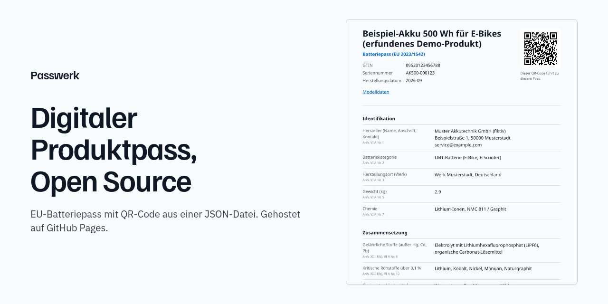

<p align="center"></p>

<h1 align="center">Passwerk: Digitaler Produktpass und EU-Batteriepass, Open Source</h1>

<p align="center"><strong>Eine JSON-Datei je Produktmodell, daraus statische Passseiten mit QR-Code nach GS1 Digital Link. Gehostet auf GitHub Pages oder jedem Webspace, ohne Abo, ohne Server. Mit Editor im Browser, Pflichtfeld-Prüfung nach Anhang XIII der Batterieverordnung und KI-Import aus Datenblättern.</strong></p>

<p align="center">
  <a href="https://brickystudios.github.io/digitaler-produktpass/editor/"></a>
  <br>
  <a href="https://eur-lex.europa.eu/legal-content/DE/TXT/?uri=CELEX:32023R1542"></a>
  <a href="https://eur-lex.europa.eu/legal-content/DE/TXT/?uri=CELEX:32024R1781"></a>
  <a href="#qr-code-und-adressen"></a>
  <a href="package.json"></a>
  <a href="LICENSE"></a>
  <a href="https://github.com/BrickyStudios/digitaler-produktpass/commits/main"></a>
  <a href="https://github.com/BrickyStudios/digitaler-produktpass/stargazers"></a>
</p>

<p align="center">
  <a href="https://brickystudios.github.io/digitaler-produktpass/">Website</a> ·
  <a href="https://brickystudios.github.io/digitaler-produktpass/01/09520123456788/21/AK500-000123/">Beispielpass</a> ·
  <a href="https://brickystudios.github.io/digitaler-produktpass/batteriepass/">Pflichtangaben</a> ·
  <a href="https://brickystudios.github.io/digitaler-produktpass/digitaler-produktpass-ab-wann/">Fristen</a> ·
  <a href="#english">English</a>
</p>

---

Ab dem 18. Februar 2027 braucht jede LMT-, Industrie- (über 2 kWh) und Elektrofahrzeugbatterie, die in der EU in Verkehr kommt, einen digitalen Batteriepass (Art. 77 der Verordnung (EU) 2023/1542). Erreichbar ist er über einen QR-Code auf der Batterie. Weitere Produktgruppen folgen über die Ökodesign-Verordnung.

Passwerk erzeugt den öffentlichen Teil dieses Passes als statische Webseiten. Sie brauchen dafür keinen Server und kein Abo: Die Daten stehen in einer JSON-Datei im Repository, GitHub Actions baut daraus bei jedem Push eine Seite pro Seriennummer.

## Was Passwerk macht

| | |
|---|---|
| **Passseiten** | Eine Seite je Modell und je Seriennummer, mit allen öffentlichen Feldern aus Anhang XIII und der Fundstelle zu jedem Feld |
| **QR-Code** | SVG unter jeder Seite, Adresse nach GS1 Digital Link: `/01/<GTIN>/21/<Seriennummer>/` |
| **Prüfung** | Fehlende Pflichtangaben, kaputte Links, falsche GTIN-Prüfziffern und doppelte Seriennummern brechen den Build ab |
| **Maschinenlesbar** | `passport.json` neben jeder Seite, dazu schema.org-`Product` als JSON-LD im Quelltext |
| **Editor** | Formular im Browser mit Live-Vorschau, Download als JSON, HTML-Seite, QR-Code als SVG und PNG. Daten bleiben im Browser |
| **KI-Import** | Claude liest mehrere Dokumente auf einmal (Datenblatt, Zertifikate, Herstellererklärung) und füllt die Felder vor, jeweils mit Datei und Seite als Quelle. Läuft mit Ihrem eigenen Anthropic-API-Schlüssel direkt aus dem Browser, jeder Vorschlag bleibt markiert, bis Sie ihn prüfen |
| **Quellen** | Die Quelle jedes Werts steht in der Passdatei (`sources`) und klein unter dem Wert auf der Passseite |
| **Lieferanten-Anfrage** | Ein Klick erzeugt eine E-Mail mit allen fehlenden Angaben und ihren Fundstellen |
| **Etiketten** | Druckbogen mit allen QR-Codes eines Modells unter `/01/<GTIN>/etiketten/` |
| **Versionierung** | Jede Passseite zeigt das Datum der letzten Änderung und verlinkt den Git-Verlauf der Passdatei |
| **Pflicht-Check** | [Vier Fragen](https://brickystudios.github.io/digitaler-produktpass/batteriepass-pflicht-check/) klären, ob Ihre Batterie einen Pass braucht |
| **Index** | `/passports.json` listet alle Pässe und Seriennummern mit ihren Adressen |
| **Vorlagen** | Batteriepass nach Verordnung (EU) 2023/1542 und ein ESPR-Grundgerüst für andere Produkte |

### Was Passwerk nicht macht

- **Zugriffssteuerung.** Detaillierte Zusammensetzung, Demontage, Prüfberichte und Nutzungsdaten (Anhang XIII Nr. 2 bis 4) dürfen nur Berechtigte sehen. Passwerk veröffentlicht sie nicht, es zeigt einen Kontakt dafür an.
- **Langzeitarchiv.** Der Pass muss erreichbar bleiben, auch wenn Ihr Unternehmen aufhört (Art. 78 Buchst. e). Ein GitHub-Konto allein sichert das nicht. Spiegeln Sie die Seiten auf eine eigene Domain mit Hosting-Vertrag.
- **Rechtsberatung.** Passwerk bildet die Felder aus dem Gesetzestext ab. Ob Ihr Pass vollständig ist, klären Sie in Ihrer Konformitätsbewertung.

## Schnellstart

```sh
git clone https://github.com/BrickyStudios/digitaler-produktpass
cd digitaler-produktpass
npm test           # Tests ohne Netz
npm run build      # Pässe aus passports/ nach _site/
npm run preview    # http://localhost:8080
```

Node 20 oder neuer. Es gibt keine Abhängigkeiten zu installieren.

## Eigene Pässe auf GitHub Pages

1. Repository forken.
2. Unter **Settings**, **Pages** als Quelle **GitHub Actions** wählen.
3. Eine JSON-Datei je Produktmodell in `passports/` legen. Am einfachsten im [Editor](https://brickystudios.github.io/digitaler-produktpass/editor/) ausfüllen und herunterladen.
4. Committen und pushen. Der Workflow [`pages.yml`](.github/workflows/pages.yml) testet, baut und veröffentlicht.

Die Adresse Ihrer Seiten setzt der Workflow selbst (`https://<konto>.github.io/<repo>/`). Mit eigener Domain unter Pages ändert sie sich mit. Die Projekt-Website in `website/` brauchen Sie in Ihrem Fork nicht: Löschen Sie den Ordner, dann baut `build.mjs` nur Pässe und Editor.

## Aufbau einer Passdatei

```json
{
  "template": "battery",
  "id": "akku-500",
  "language": "de",
  "gtin": "09520123456788",
  "productName": "Akku 500 Wh",
  "manufacturer": "Muster GmbH\nBeispielstraße 1, 50000 Musterstadt",
  "category": "lmt",
  "chemistry": "Lithium-Ionen, NMC 811 / Graphit",
  "ratedCapacityAh": 13.9,
  "sources": { "chemistry": "datenblatt.pdf, S. 2" },
  "items": [
    { "serial": "AK500-000123", "manufactureDate": "2026-09" }
  ]
}
```

Alle Felder mit Fundstelle stehen in [`site/lib/templates.mjs`](site/lib/templates.mjs). Ein vollständiges Beispiel liegt in [`passports/beispiel-ebike-akku.json`](passports/beispiel-ebike-akku.json). Die GTIN dort beginnt mit 952, dem Präfix, das GS1 für Beispiele reserviert hat.

## QR-Code und Adressen

| Fall | Adresse |
|---|---|
| Modell mit GTIN | `/01/09520123456788/` |
| Einzelne Batterie | `/01/09520123456788/21/AK500-000123/` |
| Ohne GTIN | `/p/<id>/` und `/p/<id>/<Seriennummer>/` |
| Etikettenbogen | `/01/09520123456788/etiketten/` |
| Alle Pässe | `/passports.json` |

Art. 77 Abs. 3 verlangt eine eindeutige Kennung nach ISO/IEC 15459. GS1 ist eine Vergabestelle nach dieser Normreihe; eine GTIN bekommen Sie mit einer Mitgliedschaft bei GS1 Germany. Den QR-Code jeder Seite finden Sie als `qr.svg` daneben (Fehlerkorrektur M, Ruhezone vier Module).

## KI-Import und Datenschutz

Der Import läuft komplett im Browser: Das PDF und Ihr API-Schlüssel gehen direkt an `api.anthropic.com`, nicht an Passwerk oder GitHub. Der Schlüssel bleibt nur im Speicher, außer Sie haken „bis zum Schließen des Tabs merken“ an (dann `sessionStorage`). Modell: `claude-opus-5-5`, Ausgabe als JSON nach Schema, mit serverseitigem Fallback bei Ablehnung. Die Kosten rechnet Anthropic nach Verbrauch mit Ihnen ab. Der Entwurf im Editor liegt in `localStorage` Ihres Browsers.

Die Website lädt keine Schriften, Skripte oder Tracker von fremden Servern.

## Ordner

| Pfad | Inhalt |
|---|---|
| `passports/` | Ihre Passdaten, eine JSON-Datei je Modell |
| `site/lib/` | Vorlagen, Prüfung, Seitenaufbau, QR-Code. Läuft im Browser und in Node |
| `site/editor/` | Editor und KI-Import |
| `build.mjs` | baut `_site/` |
| `website/` | Projekt-Website mit Ratgebern (für Forks entbehrlich) |
| `test/` | Tests mit `node --test` |

## Lizenz

[PolyForm Shield 1.0.0](LICENSE). Nutzen, im eigenen Unternehmen einsetzen, anpassen und weitergeben ist kostenlos erlaubt. Nicht erlaubt ist, Passwerk oder eine veränderte Fassung als Produkt oder Dienst anzubieten, der mit Passwerk konkurriert. Der Quellcode ist offen, eine Open-Source-Lizenz im Sinne der Open Source Initiative ist das nicht.

Mitgelieferter Fremdcode behält seine Lizenz: der QR-Code-Generator von Kazuhiko Arase ([MIT](site/lib/vendor/qrcode.mjs)), das Anthropic-SDK ([MIT](site/editor/vendor/LICENSE-anthropic-sdk.txt)) und die Schriften Familjen Grotesk, IBM Plex Sans und JetBrains Mono ([SIL OFL 1.1](site/assets/fonts/)).

---

<details id="english"><summary>English</summary>

Passwerk is a source-available generator for EU digital product passports. From 18 February 2027 every LMT, industrial (above 2 kWh) and electric vehicle battery sold in the EU needs a battery passport reachable through a QR code (Art. 77 of Regulation (EU) 2023/1542).

You keep one JSON file per product model in `passports/`. On every push, GitHub Actions validates the required fields from Annex XIII, then builds one static page per model and per serial number, each with a GS1 Digital Link QR code, a `passport.json` and schema.org JSON-LD. No server, no subscription.

The [browser editor](https://brickystudios.github.io/digitaler-produktpass/editor/) (German interface) checks required fields live and exports JSON, a standalone HTML page and the QR code. Its optional AI import sends a datasheet straight from your browser to the Anthropic API with your own key.

Passwerk publishes the public part of the passport only. It has no access control for the restricted data in Annex XIII points 2 to 4, and a GitHub account alone does not keep the passport online after your company stops trading (Art. 78(e)), so mirror the pages on a domain you control.

Guides in English: [battery passport](https://brickystudios.github.io/digitaler-produktpass/en/battery-passport/), [DPP software](https://brickystudios.github.io/digitaler-produktpass/en/dpp-software/). Licence: PolyForm Shield 1.0.0, free to use and modify, not for offering a competing product.

</details>
